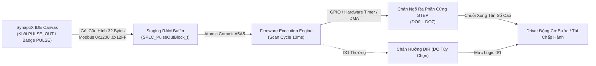

# TÀI LIỆU ĐẶC TẢ GIAO DIỆN PHẦN CỨNG & PHẦN SỤN (ICD)
## SPLC-SPEC-PULSE-003: KHỐI PHÁT XUNG PHẦN CỨNG & ĐIỀU KHIỂN CHẤP HÀNH (PULSE_OUT)

**Mã tài liệu:** `SPLC-SPEC-PULSE-003` (Kế thừa và chuẩn hóa từ `SPLC-SPEC-DIR-003`)  
**Phiên bản:** `v2.2.0` (Chuẩn hóa vòng đời PTO Trig/Done/Busy/Error, loại bỏ COV, hỗ trợ chọn chip Bus LED WS2812B/UCS16703 qua flags)  
**Ngày phát hành:** `2026-11-21`  
**Trạng thái:** `APPROVED / AUTHORITATIVE SPECIFICATION`  
**Phạm vi áp dụng:** Firmware vi điều khiển SimplePLC / SynaptiX (STM32H5/G4/F4, ESP32-S3, RP2040, GD32), SynaptiX IDE Studio, Bo mạch Remote I/O RIO-884, Smart PLC Controller.

---

### 1. Tổng Quan Kiến Trúc (Architecture Overview)

Khối chức năng **`PULSE_OUT` (Pulse Output / Bộ Phát Xung Phần Cứng - Huy hiệu Canvas: `PULSE`, mã nhị phân tương thích: `DIRECT_WRITE`)** cho phép bộ điều khiển phát xung định lượng hoặc xuất lệnh chấp hành trực tiếp tới **một chân ngõ ra số phần cứng duy nhất (`DO0..DO7`)** của thiết bị mà **không cần thông qua giao thức truyền thông mạng Modbus RTU Slave ID**:

1. **Chuẩn hóa danh mục chân ngõ ra theo thiết bị (`DO0..DO7`):**
   - Không sử dụng các định danh tùy biến hoặc không đồng nhất (như `OUT1..4` hay `FAST_IO`).
   - Mọi chân ngõ ra số trong hệ sinh thái SimplePLC đều tuân thủ định danh duy nhất là **`DO`** (`DO0`, `DO1`, `DO2`, `DO3`, `DO4`, `DO5`, `DO6`, `DO7`...), đồng bộ 100% với Bảng Tag Catalog, Bàn I/O ảo và Bảng quy tắc logic (Rule Table).
2. **Các chế độ vận hành hỗ trợ:**
   - **Mode 0: Digital Output (`DO`):** Đóng/ngắt trực tiếp mức logic 0/1 (Relay, Van điện từ Solenoid, Đèn báo trạng thái), hỗ trợ cấu hình cực tính `Active High / Active Low` và trạng thái an toàn `Fail-Safe (0 - OFF / 1 - ON)`. Vận hành theo cơ chế bám mức liên tục (`Continuous Level-Following`).
   - **Mode 1: PWM Duty Cycle (`PWM`):** Điều chế độ rộng xung công suất $0 \dots 100\%$ điều khiển độ sáng LED dimmer, van tỉ lệ khí nén/thủy lực, hoặc bộ điều tốc động cơ DC thông qua Hardware Timer CCR.
   - **Mode 2: Pulse Train Output (`PTO`):** Phát chuỗi xung định lượng độ chính xác cao điều khiển bộ điều khiển động cơ bước (Stepper Driver STEP pin) hoặc phát xung đo lường. Khối quản lý chân phát xung STEP; chân hướng DIR được điều khiển độc lập qua một chân DO thông thường. Khối cung cấp đầy đủ vòng đời thực thi: `Trig` (kích hoạt) $\to$ `Busy` (đang phát) $\to$ `Done` (hoàn tất 1 scan pass) $\to$ `Error` (lỗi timer).
   - **Mode 3: Addressable Actuator Bus (`BUS`):** Giao tiếp nối tiếp 1 dây điều khiển dải LED địa chỉ hóa (WS2812B, UCS16703) phục vụ bài toán hiển thị chỉ thị vị trí (Pick-to-Light / Sorting Pocket) qua DMA cao tốc 800 kHz. Hỗ trợ chọn chuẩn chip qua cờ `flags`.



---

### 2. Bản Đồ Bộ Nhớ Thanh Ghi Modbus (Memory Map)

Vùng nhớ cấu hình cho các khối `PULSE_OUT` (tương thích `DIRECT_WRITE`) được định vị tại dải thanh ghi **`0x1200` $\dots$ `0x12FF`** (tối đa **8 khối độc lập**, mỗi khối chiếm **16 thanh ghi Modbus = 32 bytes nhị phân**):

$$\text{Base Address} = 0\text{x}1200 + (\text{BlockIndex} \times 16) \quad (\text{BlockIndex} = 0 \dots 7)$$

#### Bảng cấu trúc chi tiết từng khối (32 Bytes / 16 Modbus Registers)

> [!IMPORTANT]
> **Quy chuẩn Endianness trên Bus Modbus RTU:**  
> Toàn bộ các thanh ghi Modbus Holding Registers của SimplePLC đều là **Big-Endian**:  
> - Dữ liệu 16-bit: High Byte (MSB) truyền trước, Low Byte (LSB) truyền sau.
> - Các thanh ghi ghép 2 biến byte: Biến khai báo trước nằm ở Byte Cao (Bits 15..8), biến khai báo sau nằm ở Byte Thấp (Bits 7..0).
> - Dữ liệu 32-bit: Trải trên 2 thanh ghi liên tiếp với **High Word trước (Reg N), Low Word sau (Reg N+1)**.

| Offset Byte | Thanh ghi Modbus | Tên trường | Kiểu dữ liệu | Diễn giải kỹ thuật & Phân bổ Byte |
| :---: | :---: | :--- | :--- | :--- |
| `0x00..0x01` | Reg 0 | `mode` / `target_pin` | `uint16_t` | **High Byte (15..8):** `mode` (0=DO, 1=PWM, 2=PTO, 3=Bus)<br>**Low Byte (7..0):** `target_pin` (0=DO0 .. 7=DO7) |
| `0x02..0x03` | Reg 1 | `channel_count` | `uint16_t` | Số lượng LED trong chế độ Bus (1..256), hoặc số xung định lượng cơ sở dự phòng cho PTO khi `channel_tag_index == 0xFFFF`. |
| `0x04..0x05` | Reg 2 | `trigger_mode` / `flags` | `uint16_t` | **High Byte (15..8):** `trigger_mode` (0=RisingEdge, 1=Continuous)<br>**Low Byte (7..0):** `flags`<br>• Bit 0: `is_active_high` (1=Active High, 0=Active Low)<br>• Bit 1: `is_exclusive` (Bus Mode: độc quyền 1 kênh sáng, các kênh khác tắt)<br>• Bit 2: `fail_safe` (Trạng thái an toàn: 0=OFF, 1=ON)<br>• Bit 3..7: `reserved` (luôn điền 0) |
| `0x06..0x07` | Reg 3 | `pulse_width_us` | `uint16_t` | Độ rộng xung cơ sở tính bằng micro-giây ($\mu\text{s}$, Big-Endian). Mặc định 50 $\mu\text{s}$. |
| `0x08..0x0B` | Reg 4..5 | `pwm_freq_hz` | `uint32_t` | Tần số sóng mang PWM (Hz) hoặc tần số phát xung mặc định cho PTO khi `param_tag_index == 0xFFFF`. Reg 4 = High Word, Reg 5 = Low Word. |
| `0x0C..0x0D` | Reg 6 | `duty_max` / `duty_min` | `uint16_t` | **High Byte (15..8):** `duty_max` % (0..100)<br>**Low Byte (7..0):** `duty_min` % (0..100) |
| `0x0E..0x0F` | Reg 7 | `channel_tag` | `uint16_t` | TagIndex cấp giá trị đầu vào chính: Logic In (DO), Duty % (PWM), **Số xung động 32-bit (PTO)**, hoặc Kênh LED $1..N$ (Bus) (Big-Endian, 0xFFFF = Unmapped). |
| `0x10..0x11` | Reg 8 | `param_tag` | `uint16_t` | TagIndex cấp tham số phụ: Enable En (DO), **Tần số xung phát động Hz (PTO)**, hoặc Mã màu RGB 24-bit (Bus) (Big-Endian, 0xFFFF = Unmapped). |
| `0x12..0x15` | Reg 9..10 | `default_color` | `uint32_t` | Tham số mặc định 24-bit RGB (VD: `0x0000FF00` = Xanh lục). Reg 9 = High Word, Reg 10 = Low Word. |
| `0x16..0x17` | Reg 11 | `trig_tag_index` | `uint16_t` | TagIndex kích hoạt sườn lên chân Trig ($0 \rightarrow 1$) bắt đầu phát chuỗi xung PTO (Big-Endian, 0xFFFF = Unmapped). |
| `0x18..0x19` | Reg 12 | `done_tag_index` | `uint16_t` | TagIndex cờ Done: Firmware gán $= 1$ trong đúng 1 chu kỳ quét 10ms khi phát hết số xung định lượng PTO (Big-Endian, 0xFFFF = Unmapped). |
| `0x1A..0x1B` | Reg 13 | `busy_tag_index` | `uint16_t` | TagIndex cờ Busy: Firmware gán $= 1$ khi Hardware Timer/DMA đang phát chuỗi xung, $= 0$ khi rảnh (Big-Endian, 0xFFFF = Unmapped). |
| `0x1C..0x1D` | Reg 14 | `error_tag_index` | `uint16_t` | TagIndex cờ Error: Firmware gán $= 1$ khi xảy ra lỗi cấu hình hoặc tranh chấp Timer (Big-Endian, 0xFFFF = Unmapped). |
| `0x1E..0x1F` | Reg 15 | `reserved` | `uint16_t` | Vùng đệm dự phòng mở rộng (1 thanh ghi = 2 bytes, luôn điền `0x0000`). |

---

### 3. Định Nghĩa C Struct Chuẩn Cho Firmware Nhúng

Được khai báo chính thức tại header chuẩn [`src/SimplePLC.Protocol/Firmware/simpleplc_protocol_v2_0.h`](file:///g:/HoaNV/Projects/SimplePLC/src/SimplePLC.Protocol/Firmware/simpleplc_protocol_v2_0.h):

```c
#ifndef SPLC_PULSE_OUT_ICD_H
#define SPLC_PULSE_OUT_ICD_H

#include <stdint.h>
#include <stdbool.h>

#pragma pack(push, 1)

/**
 * @brief Định danh chân ngõ ra số DO trên thiết bị SimplePLC
 */
typedef enum {
    SPLC_DIR_PIN_DO0 = 0,
    SPLC_DIR_PIN_DO1 = 1,
    SPLC_DIR_PIN_DO2 = 2,
    SPLC_DIR_PIN_DO3 = 3,
    SPLC_DIR_PIN_DO4 = 4,
    SPLC_DIR_PIN_DO5 = 5,
    SPLC_DIR_PIN_DO6 = 6,
    SPLC_DIR_PIN_DO7 = 7
} SPLC_DirectPin_t;

/**
 * @brief Chế độ điều khiển ngõ ra / phát xung
 */
typedef enum {
    SPLC_DIR_MODE_DIGITAL_OUTPUT  = 0, /* Xuất mức logic 0/1 (Relay / Van Solenoid / Đèn báo) */
    SPLC_DIR_MODE_PWM_DUTY        = 1, /* Điều chế độ rộng xung 0..100% (Dimmer / Motor Speed) */
    SPLC_DIR_MODE_PULSE_TRAIN     = 2, /* Phát chuỗi xung bước (PTO cho Stepper / Servo STEP pin) */
    SPLC_DIR_MODE_ADDRESSABLE_BUS = 3  /* 1-wire addressable actuator bus (800 kHz NZR stream) */
} SPLC_DirectMode_t;

/**
 * @brief Cơ chế kích hoạt xuất tín hiệu
 */
typedef enum {
    SPLC_DIR_TRIG_RISING_EDGE = 0,     /* Kích hoạt theo sườn lên của chân Trig (PTO / One-shot) */
    SPLC_DIR_TRIG_CONTINUOUS  = 1      /* Cập nhật liên tục theo từng chu kỳ quét scan pass (DO / PWM) */
} SPLC_DirectTrigger_t;

/**
 * @brief Định nghĩa Bitmask cờ điều khiển (flags)
 */
#define SPLC_PULSE_FLAG_ACTIVE_HIGH     (1 << 0) /* Bit 0: 1=Active High, 0=Active Low */
#define SPLC_PULSE_FLAG_EXCLUSIVE       (1 << 1) /* Bit 1: 1=Độc quyền kênh Bus (tắt các kênh khác) */
#define SPLC_PULSE_FLAG_FAIL_SAFE       (1 << 2) /* Bit 2: Trạng thái an toàn mất kết nối (0=OFF, 1=ON) */

/**
 * @brief Cấu trúc dữ liệu nhị phân 32-byte của khối PULSE_OUT / DIRECT_WRITE
 * Kích thước: đúng 16 thanh ghi Modbus (32 bytes).
 */
typedef struct {
    uint8_t  target_pin;        /* SPLC_DirectPin_t: DO0..DO7 (0..7) */
    uint8_t  mode;              /* SPLC_DirectMode_t: 0=DO, 1=PWM, 2=PTO, 3=Bus */
    uint16_t channel_count;     /* Số kênh Bus (1..256) hoặc số xung định lượng cơ sở dự phòng cho PTO */
    uint8_t  flags;             /* SPLC_PULSE_FLAG_*: Bit 0: ActiveHigh, Bit 1: Exclusive, Bit 2: FailSafe (Bits 3..7: reserved) */
    uint8_t  trigger_mode;      /* SPLC_DirectTrigger_t: 0=RisingEdge, 1=Continuous */
    uint16_t pulse_width_us;    /* Độ rộng xung tính bằng micro-giây (µs) */
    uint32_t pwm_freq_hz;       /* Tần số sóng mang PWM hoặc tần số phát xung mặc định PTO (Hz) */
    uint8_t  duty_min;          /* Giới hạn Duty nhỏ nhất % (0..100) */
    uint8_t  duty_max;          /* Giới hạn Duty lớn nhất % (0..100) */
    uint16_t channel_tag_index; /* TagIndex cấp số xung động 32-bit (PTO) / Logic In (DO) / Duty % (PWM) / Kênh (Bus) */
    uint16_t param_tag_index;   /* TagIndex cấp tần số xung động Hz (PTO) / Enable En (DO) / Màu RGB (Bus) */
    uint32_t default_color_rgb; /* Tham số màu sắc mặc định 24-bit RGB (0x00RRGGBB) */
    uint16_t trig_tag_index;    /* TagIndex kích hoạt sườn lên chân Trig (0xFFFF = Unmapped) */
    uint16_t done_tag_index;    /* TagIndex cờ báo hoàn tất phát xung (1 scan cycle, 0xFFFF = Unmapped) */
    uint16_t busy_tag_index;    /* TagIndex cờ báo đang bận phát xung (0xFFFF = Unmapped) */
    uint16_t error_tag_index;   /* TagIndex cờ báo lỗi phần cứng/timer (0xFFFF = Unmapped) */
    uint16_t reserved;          /* Đệm căn chỉnh đúng 32 bytes (luôn ghi 0x0000) */
} SPLC_DirectWriteBlock_t;

/* Chuẩn hóa định danh tương thích cho PULSE_OUT */
typedef SPLC_DirectPin_t        SPLC_PulsePin_t;
typedef SPLC_DirectMode_t       SPLC_PulseMode_t;
typedef SPLC_DirectTrigger_t    SPLC_PulseTrigger_t;
typedef SPLC_DirectWriteBlock_t SPLC_PulseOutBlock_t;

#pragma pack(pop)

#endif // SPLC_PULSE_OUT_ICD_H
```

---

### 4. Thuật Toán Thực Thi Chi Tiết Trên Firmware MCU

#### 4.1. Chế độ 0: Digital Output (`DO`)
1. **Chế độ kích hoạt:** Mặc định vận hành theo cơ chế **`Continuous Level-Following`** (bám sát logic từng vòng quét 10ms).
2. **Kiểm tra cờ cho phép (Enable):** Nếu `param_tag_index != 0xFFFF`, đọc giá trị Tag tương ứng. Nếu giá trị $= 0$, tắt chân ngõ ra (về trạng thái nghỉ an toàn).
3. **Đọc mức logic yêu cầu:** Đọc giá trị từ `channel_tag_index`. Mức khác $0$ là yêu cầu kích hoạt, $0$ là yêu cầu ngắt.
4. **Áp dụng cực tính (`is_active_high` - Bit 0 flags):**
   - Nếu `is_active_high == true`: Mức 1 xuất điện áp $24\text{ VDC}$ (BẬT), Mức 0 ngắt điện áp $0\text{ VDC}$ (TẮT).
   - Nếu `is_active_high == false` (Active Low): Mức 0 xuất $24\text{ VDC}$, Mức 1 ngắt $0\text{ VDC}$.
5. **Xử lý Fail-Safe (Bit 2 flags):** Khi hệ thống khởi động hoặc xảy ra mất kết nối / Watchdog timeout, chân ngõ ra tự động duy trì giá trị `fail_safe` (0 = Ngắt tải hoàn toàn, 1 = Duy trì cấp tải).

#### 4.2. Chế độ 1: PWM Duty Cycle (`PWM`)
1. **Đọc giá trị Duty:** Đọc giá trị phần trăm từ `channel_tag_index` ($0 \dots 100\%$).
2. **Kẹp biên an toàn (Duty Clamping):**
   $$\text{Duty}_{\text{clamped}} = \max(\text{duty\_min}, \min(\text{Duty}_{\text{read}}, \text{duty\_max}))$$
3. **Cập nhật phần cứng Timer:** Cập nhật thanh ghi Compare/Capture Register (CCR) của Hardware Timer mà không làm gián đoạn chu kỳ sóng mang:
   $$\text{CCR} = \frac{\text{Duty}_{\text{clamped}}}{100.0} \times \text{ARR}$$

#### 4.3. Chế độ 2: Pulse Train Output (`PTO`)
1. **Phân định STEP vs DIR:**
   - Khối `PULSE_OUT` chỉ cấu hình và phát chuỗi xung cho chân **STEP** (`target_pin` DO0..DO7) thông qua Hardware Timer.
   - Chân hướng **DIR** (Direction) được coi là một DO thông thường do logic FBD / Rule Engine điều khiển độc lập trước khi kích hoạt phát xung.
2. **Xác định số xung & tần số phát:**
   - **Số xung cần phát ($N$):** Nếu `channel_tag_index != 0xFFFF`, đọc giá trị số nguyên có dấu 32-bit (`as_int32` / `DINT`) từ Tag tương ứng. Nếu `channel_tag_index == 0xFFFF`, lấy giá trị dự phòng 16-bit từ `channel_count`. Nếu $N \le 0$, không thực hiện.
   - **Tần số phát ($F$ Hz):** Nếu `param_tag_index != 0xFFFF`, đọc giá trị tần số động (Hz) từ Tag tương ứng. Nếu `param_tag_index == 0xFFFF`, lấy tần số mặc định từ `pwm_freq_hz`.
3. **Phát hiện kích hoạt sườn lên (Trig):**
   - Đọc giá trị Tag tại `trig_tag_index`. Khi phát hiện chuyển mức $0 \rightarrow 1$ (Rising Edge) và hệ thống đang rảnh (`busy == 0`):
4. **Quản lý vòng đời thực thi (FSM Lifecycle):**
   - Set cờ **`Busy = 1`** (ghi vào Tag `busy_tag_index` nếu có cấu hình).
   - Clear cờ **`Done = 0`** và **`Error = 0`**.
   - Cấu hình Hardware Timer (chế độ One-Pulse Mode hoặc nạp DMA lặp chu kỳ) phát đúng $N$ chu kỳ xung với tần số $F$.
5. **Báo hoàn tất ngắt Timer (`Done`):**
   - Khi ngắt Timer/DMA báo đã phát đủ $N$ xung:
     - Set cờ **`Busy = 0`**.
     - Phát xung cờ **`Done = 1` trong đúng 1 chu kỳ quét logic (10ms)** vào Tag `done_tag_index`, sau đó tự động reset về $0$.
   - Nếu tần số $F$ vượt quá năng lực phần cứng Timer hoặc Timer đang bận mà bị trigger trái phép: Set cờ **`Error = 1`** vào Tag `error_tag_index`.

#### 4.4. Chế độ 3: Addressable Actuator Bus (`BUS`)
1. **Chuẩn truyền thông 1-Wire 800 kHz danh định:**
   - Tần số sóng mang 800 kHz ($1.25\,\mu\text{s}$ chu kỳ bit), thời gian xung Reset $> 50\,\mu\text{s}$.
   - Định dạng dữ liệu màu danh định là **G - R - B** (24 bits mỗi phần tử chấp hành).
2. **Xử lý độc quyền kênh (`is_exclusive == true` - Bit 1 flags):**
   - Khi bật: Firmware tự động xóa toàn bộ các bóng trong dải $1 \dots \text{channel\_count}$ về màu đen (`0x000000`), chỉ duy nhất bóng tại kênh chỉ định được sáng màu.
   - Khi tắt: Firmware giữ nguyên trạng thái các bóng khác, chỉ cập nhật màu cho bóng tại kênh chỉ định.
3. **Ánh xạ kênh & màu:**
   - Đọc vị trí kênh từ `channel_tag_index` ($1 \dots \text{channel\_count}$).
   - Đọc mã màu RGB 24-bit từ `param_tag_index`. Nếu unmapped (`0xFFFF`), sử dụng `default_color_rgb`.
4. **Truyền dữ liệu bằng DMA:** Khởi động luồng DMA xuất chuỗi bit ra chân ngõ ra vật lý mà **không làm nghẽn hoặc kéo dài chu kỳ quét 10ms của PLC Engine**.

---

### 5. Mã Nguồn Mẫu Tích Hợp Trên Firmware MCU

#### Triển khai trên STM32 HAL (Timer PWM, PTO Interrupt & GPIO)

```c
#include "simpleplc_protocol_v2_0.h"
#include "main.h"

// Bảng ánh xạ chân ngõ ra DO0..DO7 sang GPIO Pin & Timer Channel phần cứng
typedef struct {
    GPIO_TypeDef* port;
    uint16_t      pin;
    TIM_HandleTypeDef* htim;
    uint32_t      tim_channel;
} splc_mcu_do_mapping_t;

static const splc_mcu_do_mapping_t g_do_pins[8] = {
    { DO0_GPIO_Port, DO0_Pin, &htim1, TIM_CHANNEL_1 },
    { DO1_GPIO_Port, DO1_Pin, &htim1, TIM_CHANNEL_2 },
    { DO2_GPIO_Port, DO2_Pin, &htim2, TIM_CHANNEL_1 },
    { DO3_GPIO_Port, DO3_Pin, &htim2, TIM_CHANNEL_2 },
    { DO4_GPIO_Port, DO4_Pin, NULL,   0             },
    { DO5_GPIO_Port, DO5_Pin, NULL,   0             },
    { DO6_GPIO_Port, DO6_Pin, NULL,   0             },
    { DO7_GPIO_Port, DO7_Pin, NULL,   0             }
};

void splc_pulse_out_execute(const SPLC_PulseOutBlock_t* cfg, uint32_t in_val, uint32_t param_val, bool trig_edge) {
    if (cfg->target_pin >= 8) return;
    const splc_mcu_do_mapping_t* hw = &g_do_pins[cfg->target_pin];

    switch (cfg->mode) {
        case SPLC_DIR_MODE_DIGITAL_OUTPUT: {
            bool active_high = (cfg->flags & SPLC_PULSE_FLAG_ACTIVE_HIGH) != 0;
            bool state = (in_val != 0);
            GPIO_PinState pin_state = (state == active_high) ? GPIO_PIN_SET : GPIO_PIN_RESET;
            HAL_GPIO_WritePin(hw->port, hw->pin, pin_state);
            break;
        }

        case SPLC_DIR_MODE_PWM_DUTY: {
            if (hw->htim == NULL) return;
            uint32_t duty = in_val;
            if (duty < cfg->duty_min) duty = cfg->duty_min;
            if (duty > cfg->duty_max) duty = cfg->duty_max;
            
            uint32_t arr = __HAL_TIM_GET_AUTORELOAD(hw->htim);
            uint32_t ccr = (arr * duty) / 100;
            __HAL_TIM_SET_COMPARE(hw->htim, hw->tim_channel, ccr);
            break;
        }

        case SPLC_DIR_MODE_PULSE_TRAIN: {
            if (hw->htim == NULL) return;
            if (trig_edge) {
                // Đọc số xung 32-bit: ưu tiên in_val (channel_tag_index), fallback channel_count
                uint32_t pulses = (cfg->channel_tag_index != 0xFFFF) ? in_val : cfg->channel_count;
                // Đọc tần số: ưu tiên param_val (param_tag_index), fallback pwm_freq_hz
                uint32_t freq = (cfg->param_tag_index != 0xFFFF && param_val > 0) ? param_val : cfg->pwm_freq_hz;
                
                splc_pto_start_pulse_train(cfg->target_pin, hw->htim, hw->tim_channel, pulses, freq, cfg->done_tag_index, cfg->busy_tag_index);
            }
            break;
        }

        case SPLC_DIR_MODE_ADDRESSABLE_BUS: {
            bool is_exclusive = (cfg->flags & SPLC_PULSE_FLAG_EXCLUSIVE) != 0;
            uint32_t color = (cfg->param_tag_index != 0xFFFF) ? param_val : cfg->default_color_rgb;
            
            splc_led_bus_dispatch(cfg->target_pin, in_val, color, is_exclusive, cfg->channel_count);
            break;
        }

        default:
            break;
    }
}
```

---

### 6. Bảng Tiêu Chí Nghiệm Thu Phần Sụn (Firmware Conformance Checklist)

- [x] **Ánh xạ chân ngõ ra DO0..DO7:** Firmware nhận diện chính xác các giá trị `target_pin` từ 0 đến 7 tương ứng với các chân ngõ ra `DO0` đến `DO7` trên vỏ thiết bị.
- [x] **Thời gian đáp ứng:** Độ trễ từ khi logic cập nhật đến khi chân phần cứng đổi trạng thái nhỏ hơn một chu kỳ quét ($\le 10\text{ ms}$).
- [x] **An toàn Fail-Safe:** Khi kích hoạt lệnh khẩn cấp hoặc mất kết nối Studio, ngõ ra tự động trở về mức an toàn được chỉ định trong `fail_safe`.
- [x] **Vòng đời thực thi PTO (Trig/Busy/Done/Error):** Kích hoạt sườn lên từ `trig_tag_index`, cờ `busy_tag_index` duy trì mức 1 trong suốt thời gian phát xung, cờ `done_tag_index` xuất xung mức 1 trong đúng 1 chu kỳ quét 10ms khi ngắt Timer báo phát xong.
- [x] **Chuẩn 1-Wire Bus 800 kHz:** Xuất luồng bit qua DMA chuẩn thời gian tương thích cao, không gây nghẽn vòng quét.
- [x] **Không nghẽn chu kỳ quét:** Việc phát xung PWM cao tốc hoặc truyền chuỗi dữ liệu 800 kHz qua DMA không làm kéo dài thời gian quét danh định 10ms của bộ điều khiển.
- [x] **Không nghẽn chu kỳ quét:** Việc phát xung PWM cao tốc hoặc truyền chuỗi dữ liệu 800 kHz qua DMA không làm kéo dài thời gian quét danh định 10ms của bộ điều khiển.
